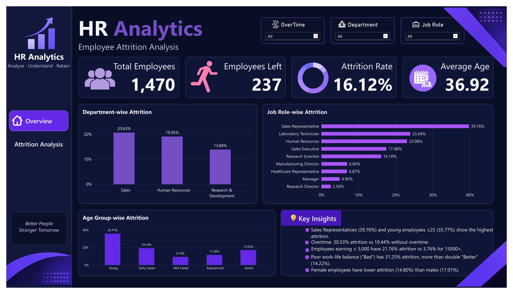

<div align="center">

# 📊 HR Analytics & Employee Attrition Analysis

### Understanding *why* employees leave: from raw data to MySQL insights to an interactive Power BI dashboard


**1,470 employees · 237 left · 16.12% attrition · 14 SQL analyses · 2-page dashboard**

</div>

---

## 📑 Table of Contents

- [Project Snapshot](#-project-snapshot)
- [Dashboard Preview](#-dashboard-preview)
- [Quick Access](#-quick-access)
- [Project Objective](#-project-objective)
- [Dataset](#-dataset)
- [Workflow](#-end-to-end-workflow)
- [SQL Analysis (MySQL)](#️-sql-analysis--mysql)
- [Power BI Dashboard](#-power-bi-dashboard)
- [Key Findings](#-key-findings)
- [Business Recommendations](#-business-recommendations)
- [Tools & Skills](#️-tools--skills)
- [Repository Structure](#-repository-structure)
- [How to Reproduce](#-how-to-reproduce)
- [Limitations](#️-limitations)
- [Copyright & Attribution](#-copyright--attribution)
- [Author](#-author)

---

## 🔑 Project Snapshot

| Metric | Value |
|---|---:|
| Total Employees | **1,470** |
| Employees Left | **237** |
| Overall Attrition Rate | **16.12%** |
| Average Age | **36.92** |
| SQL Analysis Tasks | **14** |
| Dashboard Pages | **2** (Overview + Attrition Analysis) |

---

## 🖼️ Dashboard Preview

### 1️⃣ Overview: KPIs, Department, Job Role & Age Group Attrition



### 2️⃣ Attrition Analysis: Drivers of Employee Attrition


---

## 🔗 Quick Access

| Resource | Open |
|---|---|
| 📊 Overview Dashboard | [Open PNG](./Overview.png) |
| 📈 Attrition Analysis Dashboard | [Open PNG](./Attrition%20Analysis.png) |
| 🗄️ SQL Analysis Script | [Open SQL](./hr-employees-analytics.sql) |
| 📁 Dataset | [Open CSV](./HR-Employee-Attrition.csv) |

---

## 🎯 Project Objective

Employee attrition is costly. This project analyses HR data to find **which employee segments leave the most** and **which factors are associated with leaving**, so that HR teams can plan targeted retention actions.

**Business questions answered**

- How many employees left, and what is the overall attrition rate?
- Which departments, job roles and age groups have the highest attrition?
- How are overtime, income, business travel, job satisfaction, work-life balance and tenure associated with attrition?
- Does attrition differ by gender or education field?

---

## 📌 Dataset

| Attribute | Details |
|---|---|
| Name | IBM HR Analytics Employee Attrition & Performance |
| Source | Public sample dataset (Kaggle) |
| Records | 1,470 employees |
| Unique Employee IDs | 1,470 (no duplicate `EmployeeNumber`) |
| Target Variable | `Attrition` (Yes / No) |

> ℹ️ This is a **fictional sample dataset** created by IBM data scientists for learning purposes. It does not represent a real company.

**Fields used in the analysis:** `Age`, `Attrition`, `BusinessTravel`, `Department`, `EducationField`, `Gender`, `JobRole`, `JobSatisfaction`, `MonthlyIncome`, `OverTime`, `WorkLifeBalance`, `YearsAtCompany`, `EmployeeNumber`

---

## 🧠 End-to-End Workflow


---

## 🗄️ SQL Analysis — MySQL

All analysis was written in **MySQL** and is available in [`hr-employees-analytics.sql`](./hr-employees-analytics.sql).

### Data cleaning & validation
- Fixed the **BOM encoding issue** in the first column (`Age` → `Age`)
- Verified column structure with `SHOW COLUMNS`
- Confirmed total record count (**1,470**)
- Checked uniqueness of `EmployeeNumber` (**1,470 distinct = 1,470 rows**)

### SQL skills demonstrated
`SELECT` · `GROUP BY` · `ORDER BY` · `COUNT` · `SUM` · `ROUND` · `CASE WHEN` (conditional aggregation & bucketing) · `COUNT(DISTINCT)` · attrition-rate calculation

<details>
<summary><b>📋 View all 14 analysis tasks</b></summary>

| # | Task | Business Question |
|---|---|---|
| 01 | Attrition Distribution | How many employees left vs stayed? |
| 02 | Duplicate Check | Are Employee Numbers unique? |
| 03 | Overall Attrition Rate | What is the overall attrition rate? |
| 04 | Department-wise Attrition | Which department has the highest attrition? |
| 05 | Job Role-wise Attrition | Which job role has the highest attrition? |
| 06 | Age Group-wise Attrition | Which age group has the highest attrition? |
| 07 | Overtime vs Attrition | Is overtime associated with attrition? |
| 08 | Monthly Income vs Attrition | Which income band has the highest attrition? |
| 09 | Job Satisfaction vs Attrition | How does satisfaction relate to attrition? |
| 10 | Business Travel vs Attrition | Does frequent travel relate to attrition? |
| 11 | Tenure vs Attrition | Which tenure group has the highest attrition? |
| 12 | Work-Life Balance vs Attrition | How does work-life balance relate to attrition? |
| 13 | Gender-wise Attrition | How does attrition differ by gender? |
| 14 | Education Field vs Attrition | Which education field has the highest attrition? |

</details>

<details>
<summary><b>💻 Sample query: Attrition rate by department</b></summary>

```sql
SELECT
    Department,
    COUNT(*) AS total_employees,
    SUM(CASE WHEN Attrition = 'Yes' THEN 1 ELSE 0 END) AS Left_employees,
    ROUND(
        (SUM(CASE WHEN Attrition = 'Yes' THEN 1 ELSE 0 END) / COUNT(*)) * 100, 2
    ) AS attrition_rate
FROM `hr-employee-attrition`
GROUP BY Department
ORDER BY attrition_rate DESC;
```

</details>

### Grouping logic used

| Dimension | Buckets |
|---|---|
| **Age Group** | Young (≤25) · Early Career (26–35) · Mid Career (36–45) · Experienced (46–55) · Senior (56+) |
| **Monthly Income** | 0–5000 · 5001–10000 · 10001–15000 · 15001+ |
| **Tenure (Years at Company)** | 0–5 · 6–10 · 11–20 · 20+ |
| **Job Satisfaction** | 1 = Low · 2 = Medium · 3 = High · 4 = Very High |
| **Work-Life Balance** | 1 = Bad · 2 = Good · 3 = Better · 4 = Best |

---

## 📊 Power BI Dashboard

The dashboard has **two pages** with interactive slicers for **OverTime**, **Department** and **Job Role**, plus page navigation.

### 1️⃣ Overview page
- **KPI cards:** Total Employees · Employees Left · Attrition Rate · Average Age
- Department-wise Attrition
- Job Role-wise Attrition
- Age Group-wise Attrition
- **Key Insights** panel

### 2️⃣ Attrition Analysis page
- Overtime Impact on Attrition
- Monthly Income vs Attrition
- Job Satisfaction Analysis
- Business Travel Analysis
- Work-Life Balance Analysis
- Tenure vs Attrition
- Attrition by Education Field

### 🧮 DAX & modelling
- Attrition Rate measure (employees who left ÷ total employees)
- Calculated columns for **Tenure Group** with a custom **sort order**
- Grouped and labelled fields for age, income, satisfaction and work-life balance

---

## 📈 Key Findings

> The figures below are **observed patterns in this dataset**. They show association, not causation.

| Factor | Highest-risk segment | Attrition | Comparison |
|---|---|---:|---|
| ⏰ **Overtime** | Works overtime | **30.53%** | vs **10.44%** without overtime |
| 💼 **Job Role** | Sales Representative | **39.76%** | Research Director lowest at **2.50%** |
| 🏢 **Department** | Sales | **20.63%** | HR 19.05% · R&D 13.84% |
| 🎂 **Age Group** | Young (≤25) | **35.77%** | Mid Career (36–45) lowest at **9.19%** |
| 💰 **Monthly Income** | 0–5000 | **21.76%** | 15001+ lowest at **3.76%** |
| ⚖️ **Work-Life Balance** | Bad | **31.25%** | Better **14.22%** |
| ✈️ **Business Travel** | Travel Frequently | **24.91%** | Non-Travel **8.00%** |
| 😊 **Job Satisfaction** | Low | **22.84%** | Very High **11.33%** |
| 📅 **Tenure** | 0–5 years | **20.88%** | 11–20 years lowest at **6.67%** |
| 🎓 **Education Field** | Human Resources | **25.93%** | Other **13.41%** |
| 🚻 **Gender** | Male | **17.01%** | Female **14.80%** |

### 🔥 Highlights
- **53.6%** of all leavers (127 of 237) worked overtime.
- **68.4%** of all leavers (162 of 237) had **5 years or less** at the company.
- Overtime employees left at about **3×** the rate of non-overtime employees.
- Frequent travellers left at about **3×** the rate of non-travellers.

---

## 💡 Business Recommendations

1. **Review overtime policy:** rebalance workload, especially for Sales and Laboratory Technician roles.
2. **Strengthen early-career retention:** improve onboarding, mentoring and growth paths for employees in their first 5 years.
3. **Check pay competitiveness:** review the lowest income band (≤5,000/month), which shows the highest income-related attrition.
4. **Improve work-life balance:** reduce unnecessary frequent travel and monitor "Bad" work-life balance scores.
5. **Target Sales Representatives:** run satisfaction surveys and stay interviews for the highest-risk role.

---

## 🛠️ Tools & Skills

| Tool | Usage |
|---|---|
| **MySQL** | Data import, cleaning, validation and analysis |
| **SQL** | Conditional aggregation, bucketing, rate calculation |
| **Power BI** | Interactive dashboard, KPI cards, slicers, visual design |
| **DAX** | Measures and calculated columns |

**Skills demonstrated:** SQL · MySQL · Power BI · DAX · Data Cleaning · Data Visualization · Business Analysis · Dashboard Storytelling

---

## 📂 Repository Structure

```text
.
├── README.md
├── HR-Employee-Attrition.csv        # Dataset
├── hr-employees-analytics.sql       # MySQL analysis (14 tasks)
├── Overview.png                     # Dashboard page 1
└── Attrition Analysis.png           # Dashboard page 2
```

---

## 🚀 How to Reproduce

1. Create the database and import the CSV into MySQL (Table Data Import Wizard) as `hr-employee-attrition`.
2. Open [`hr-employees-analytics.sql`](./hr-employees-analytics.sql) and run it section by section.
3. If the first column imports as `Age`, run the rename step in Section 02.
4. Verify the totals: **1,470 rows** and **237 employees with `Attrition = 'Yes'`**.

---

## ⚠️ Limitations

- This is a **sample dataset**, so findings should not be generalised to any real organisation.
- The analysis is **descriptive**, examining one factor at a time. It does not control for combined effects and does not establish causation.
- Some groups have **small sample sizes**, so their rates are indicative rather than conclusive:
  - Human Resources education field (27 employees)
  - "Bad" work-life balance (80 employees)
  - Sales Representatives (83 employees)
  - Senior age group, 56+ (47 employees)
- Monthly income is analysed in fixed bands; the dataset does not specify a currency.

---

## 📜 Copyright & Attribution

**© 2026 Gopal Krishna. All rights reserved** for the original SQL analysis, dashboard design, documentation and visual presentation created by the author.

The underlying HR attrition dataset is third-party material (IBM HR Analytics sample dataset) used for **educational and portfolio-analysis purposes**. Ownership and licensing rights for the dataset remain with its original owner/source. This repository does not claim ownership of the dataset; anyone redistributing it should verify and follow the original usage terms.

Unauthorised copying, re-uploading or claiming this work as your own is prohibited. Commercial use requires prior written permission from the author.

---

## 👨‍💻 Author

**Gopal Krishna**
B.Tech Computer Science & Engineering | Aspiring Data Analyst

[](https://github.com/Gopal-42)
[](https://www.linkedin.com/in/gopal-krishna-217b80176)

---

<div align="center">

### ⭐ If you found this project useful, consider giving the repository a star!

*Better People · Stronger Tomorrow*

</div>
